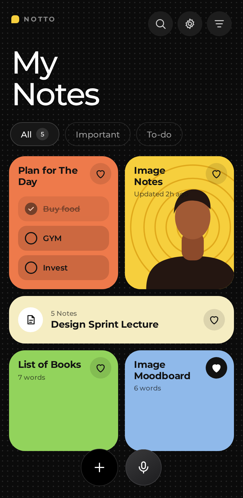
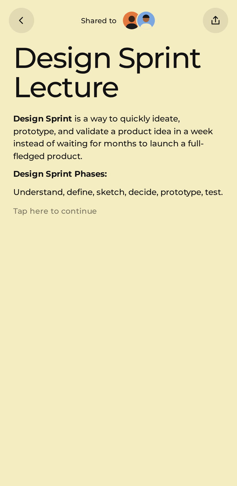
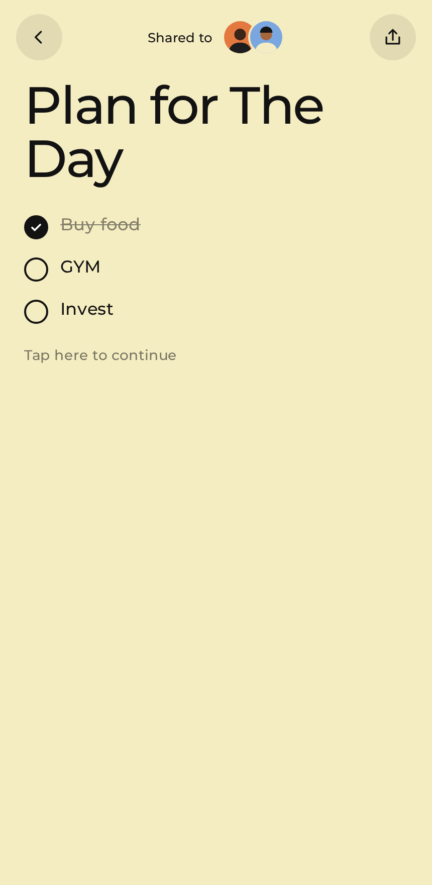
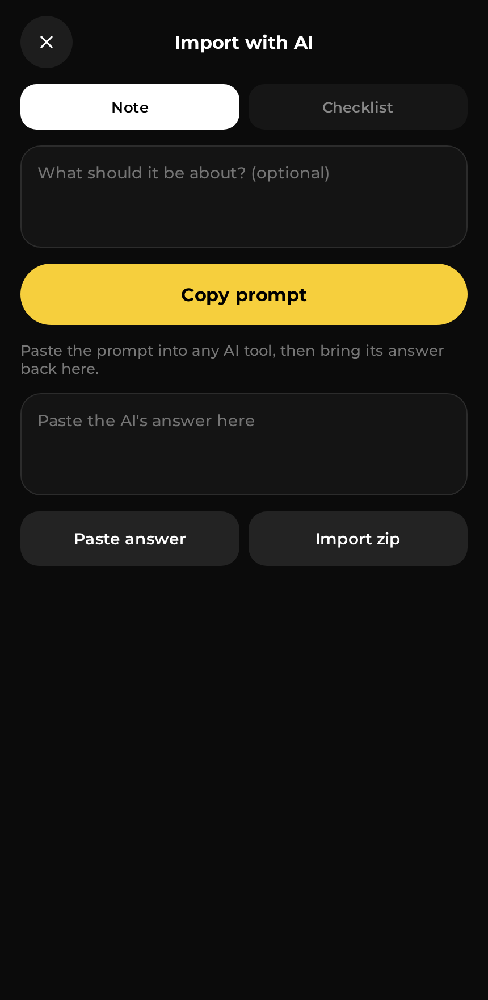
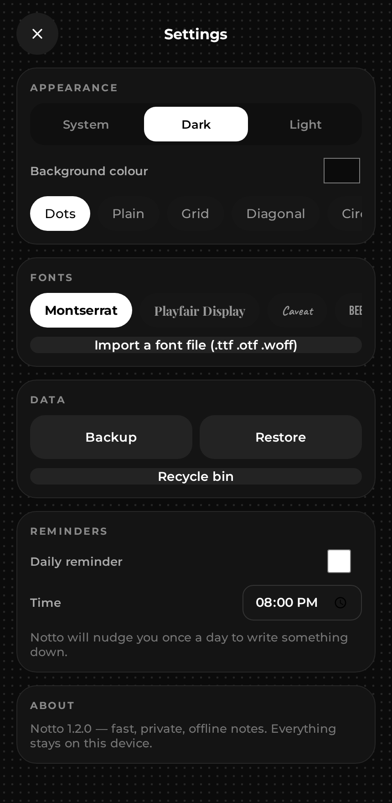

<div align="center">


# Notto

**A fast, private, offline notes app — notes, checklists, moodboards, sketches and voice.**

[](https://github.com/itsrawdevvvvvv-arch/notto/actions/workflows/build.yml)
[](https://github.com/itsrawdevvvvvv-arch/notto/releases/latest)
[](https://github.com/itsrawdevvvvvv-arch/notto/releases)
[](LICENSE)
[](#requirements)

<a href="https://github.com/itsrawdevvvvvv-arch/notto/releases/latest">
  
</a>

</div>

---

Notto is a tiny, no-nonsense note-taking app for Android. Write notes, build checklists, cut out image notes, arrange moodboards, doodle on a sketch canvas and dictate with your voice — all in one dark, tactile interface. Everything stays on your device.

<br>

<div align="center">
  
  
  
  
  
</div>

## Features

- **Notes** — rich text with bold, italic, underline, highlights, bullet and numbered lists, custom sizes, colours and fonts.
- **Checklists** — tap to tick items off; the home card shows progress at a glance.
- **Image notes & moodboards** — add photos, stickers and text, then drag, rotate, scale and layer them on a board.
- **Sketch** — a smooth free-hand canvas you can drop straight into a note.
- **Voice notes** — dictate hands-free and turn speech into a note.
- **AI import** — copy a ready-made prompt into any AI tool, paste the answer back and Notto formats it for you.
- **Export & share** — save any note as **PNG**, **PDF** or **TXT**.
- **Search & organise** — instant search, sort by newest/oldest/title, filter by type, and pin important notes.
- **Recycle bin** — restore a note you deleted by mistake.
- **Backup & restore** — export every note to one file, and import it back.
- **Make it yours** — light or dark theme, dotted / grid / diagonal backgrounds, and any background colour.
- **14 fonts, or your own** — choose from 14 built-in typefaces or import any .ttf/.otf/.woff font.
- **Voice notes** — dictate with speech to text, or record audio right inside a note.
- **Widget & reminders** — a home-screen widget, plus an optional daily nudge to write.
- **Offline by design** — no account, no tracking, no network permission. Your notes live in local storage on your device.
- **Small & fast** — one lightweight APK (about 0.6 MB), no third-party runtime.

## Download

Grab the latest signed APK from the [**Releases**](https://github.com/itsrawdevvvvvv-arch/notto/releases/latest) page.

| File | Description |
| --- | --- |
| `notto-<version>.apk` | Signed release build — install this. |
| `notto-<version>.apk.sha256` | SHA-256 checksum to verify your download. |

> Every release also attaches the checksum, and the build is reproducible from source (see [Building](#building-from-source)).

### Verify your download

```bash
sha256sum -c notto-1.1.0.apk.sha256
```

## Install

Notto is distributed as a direct APK (sideload), which is how most open-source Android apps ship outside of Google Play.

1. Download the APK from the Releases page.
2. Open it on your phone and allow "Install unknown apps" for your browser or file manager when prompted.
3. Install and open Notto.

### Requirements

- Android 6.0 (API 24) or newer.
- ~2 MB of free storage.

## Building from source

### With Gradle (recommended)

```bash
git clone https://github.com/itsrawdevvvvvv-arch/notto.git
cd notto
./gradlew assembleRelease
```

The APK lands in `app/build/outputs/apk/release/`.

To produce a **signed** release, create a keystore and expose it to Gradle:

```bash
keytool -genkeypair -v -keystore notto-release.jks -alias notto \
  -keyalg RSA -keysize 2048 -validity 10950

export NOTTO_KEYSTORE="$PWD/notto-release.jks"
export NOTTO_STORE_PASSWORD="your-store-password"
export NOTTO_KEY_ALIAS="notto"
export NOTTO_KEY_PASSWORD="your-key-password"
./gradlew assembleRelease
```

See [`docs/BUILDING.md`](docs/BUILDING.md) for the full guide, including a dependency-free build script (`scripts/build_apk.sh`) that uses the Android SDK build-tools directly.

### Project layout

```
notto/
├── app/
│   ├── build.gradle
│   └── src/main/
│       ├── AndroidManifest.xml
│       ├── java/com/notto/app/MainActivity.java   # WebView host + native bridge
│       ├── assets/
│       │   ├── index.html                         # the entire app UI
│       │   └── fonts/                             # bundled webfonts (offline)
│       └── res/                                   # icons, theme, strings
├── scripts/build_apk.sh                           # Gradle-free APK build
├── fastlane/                                      # store metadata + screenshots
├── screenshots/                                   # README images
└── docs/                                          # building, privacy
```

## How it works

Notto's interface is a single self-contained `index.html` — HTML, CSS and vanilla JavaScript — served from the app's assets. A small `WebView` host (`MainActivity.java`) loads it and bridges the handful of things a WebView cannot do on its own:

- **File picking** for photos, so image notes and moodboards work.
- **Saving exports** (PNG/PDF/TXT) to the device's Downloads folder, because WebView cannot download `blob:` URLs directly.

Because the assets ship inside the APK and the fonts are bundled, the app is **fully offline**. It declares **no `INTERNET` permission** at all.

## Privacy

Notto collects nothing and sends nothing. There are no analytics, no ads and no network access. It asks for the microphone only when you use a voice feature, and for notification permission only if you switch on reminders. Read [`docs/PRIVACY.md`](docs/PRIVACY.md).

## Contributing

Contributions are welcome! Please read [`CONTRIBUTING.md`](CONTRIBUTING.md) and our [Code of Conduct](CODE_OF_CONDUCT.md) first. Good first issues are labelled [`good first issue`](https://github.com/itsrawdevvvvvv-arch/notto/labels/good%20first%20issue).

## Changelog

See [`CHANGELOG.md`](CHANGELOG.md).

## Credits

- Typefaces bundled for offline use, all under the SIL Open Font License: **Montserrat**, **Playfair Display**, **Caveat**, **Bebas Neue**, **Space Mono** and **Pacifico**.

## License

Released under the [MIT License](LICENSE).

<div align="center"><sub>Made with care. Your notes stay yours.</sub></div>
